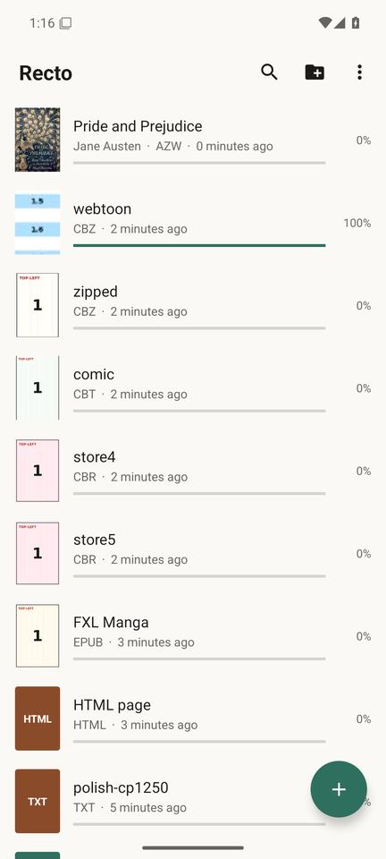
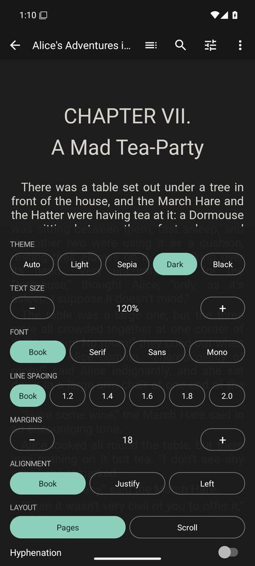
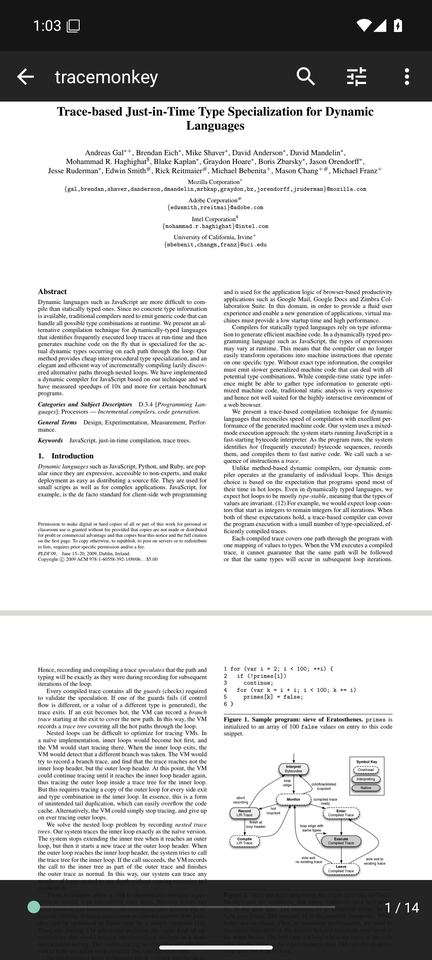
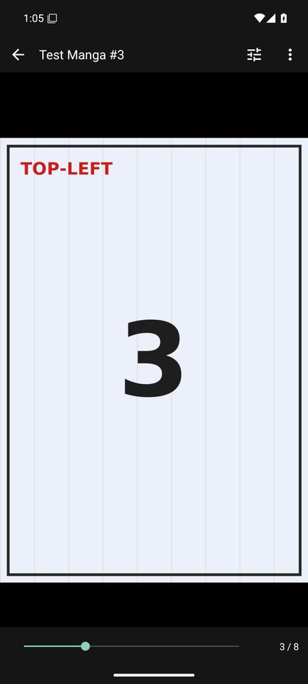
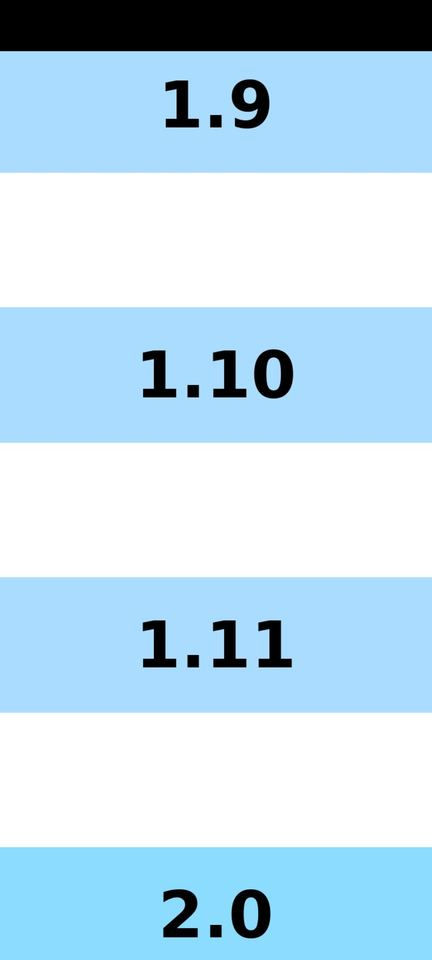

# Recto

A minimal, fast, low-memory reader for Android for **books, comics, manga and documents**.
It is free software (GPL-3.0-or-later) and has **no dependencies, no ads, no tracking and no
network permission at all**.

The whole app is a ~130 KB APK. It runs on Android 5.0 and newer (API 21+) and is tested on
Android 7.0 and Android 16.

<p>






</p>

## Formats

| Kind | Formats | Notes |
|---|---|---|
| Books | EPUB 2/3, MOBI, AZW, AZW3 (KF8), PRC, FB2, FB2.ZIP, TXT | Reflowable: themes, fonts, size, spacing, margins, hyphenation, paged or scrolling |
| Comics & manga | CBZ/ZIP, CBR (RAR 4/5, stored), CBT/TAR, fixed-layout EPUB, JPEG/PNG/WebP/GIF/BMP/HEIF/AVIF | Paged or continuous (webtoon), left-to-right or right-to-left, `ComicInfo.xml` manga flag |
| Documents | PDF, DOCX, ODT, Markdown, HTML | PDF via the system PDF engine. Search and links on Android 15+ |

## Features

* Library of recently read books with covers and progress. Optionally add folders and books inside
  them (and their subfolders) show up automatically.
* "Open with" from any file manager, `content://` and `file://`.
* Remembers the position in every book, including across font size changes and rotation
  (the reading position is anchored to a character, so it never drifts).
* Tap left/right edge or swipe to turn pages, tap the middle for the menu; volume keys and
  keyboard / D-pad / page keys turn pages too. Page turn animations can be switched off (e-ink).
* Pinch or double-tap zoom with sharp re-rendering, long webtoon strips rendered in tiles.
* Reflowable books: Light / Sepia / Dark / Black themes, book or system fonts, line spacing,
  margins, justification, hyphenation, paged (CSS columns) or scroll mode, table of contents,
  full-text search, internal links and footnotes with "back".
* PDF: continuous or paged, fit width / page, dark mode inversion (hue-preserving), page links,
  search with highlights (Android 15+), password-protected files (Android 15+).
* Text encoding detection for TXT files (UTF-8/16, windows-1250/1251/1252 and others).
* English and Polish UI.

## Download

Pre-built APKs are available on the **[Releases](https://github.com/KubeKoslaw/recto/releases/latest)** page:
* **[apk-debug.apk](https://github.com/KubeKoslaw/recto/releases/latest/download/apk-debug.apk)** (Debug build)
* **[app-release.apk](https://github.com/KubeKoslaw/recto/releases/latest/download/app-release.apk)** (Optimized release build)

## Install

Build it (below) and install `app/build/outputs/apk/release/app-release.apk`, e.g. with
`adb install app/build/outputs/apk/release/app-release.apk`.

## Build

Requirements: JDK 17 or newer and the Android SDK (platform 36, build tools are fetched automatically).

```sh
echo "sdk.dir=$HOME/Android/Sdk" > local.properties   # or set ANDROID_HOME
./gradlew assembleRelease      # minified, signed release APK (~130 KB)
./gradlew assembleDebug        # debug build
./gradlew test lint            # unit tests and lint
```

Without further setup the release APK is signed with your local debug key so it installs right away.
To sign with your own key create `keystore.properties` (it is git-ignored):

```properties
storeFile=release.jks
storePassword=...
keyAlias=recto
keyPassword=...
```

Parser tests can also run against real files: `RECTO_SAMPLES=/path/to/samples ./gradlew test`
(see `ArchiveTest` / `BooksTest` for the file names, e.g. Project Gutenberg EPUB / AZW3 / MOBI downloads).

## How it works

Plain Java and the Android framework only: no AndroidX, no Kotlin runtime, no native code.

* **Fixed layout** (`fixed/`): `PageView` is one custom view that draws pages rendered on a single
  background thread at exactly screen resolution. Tall pages are split into bands and zoomed views
  get a sharp "patch" of the visible area. The bitmap cache is bounded by the device memory class
  and prefetching never exceeds it. PDF pages come from the platform `PdfRenderer` (PDFium);
  images use power-of-two subsampling and `BitmapRegionDecoder`.
* **Reflowable** (`flow/`): every format is turned into HTML chapters (`EpubBook`, `MobiBook`,
  `Fb2Book`, `OfficeBooks`, `TextBooks`) and shown one chapter at a time in a WebView paginated
  with CSS columns (`assets/reader.js`). Content is served only through request interception: no
  file access, no network, and book scripts are blocked by a Content-Security-Policy.
* **Archives** (`io/`): small ZIP (incl. ZIP64), TAR and RAR readers working with positional reads
  on the file descriptor, so nothing is extracted or copied (streams from cloud providers are
  copied to the cache once).

## Limitations

* **Compressed RAR** (most CBR files are stored uncompressed and work) - RAR decompression is not
  available under a free license. Convert such files to CBZ. **CB7 / 7z** is not supported either.
* **DRM-protected** books (Kindle, Adobe) cannot be opened. **DjVu** and **XPS** are not supported.
* PDF search, links and passwords need Android 15+ (that is when the system API gained them).
  PDF tables of contents are not exposed by the system API.
* Android 8 and older ship an old PDF engine that may draw some PDFs without text
  (for example ones using certain embedded LaTeX fonts). Newer Android versions are fine.
* Android 11+ does not allow choosing the root of the storage or the `Download` folder itself
  as a library folder; pick a subfolder (for example `Download/Books`).

## License

GPL-3.0-or-later, see [LICENSE](LICENSE). Icons are Material Design icons (Apache-2.0).
